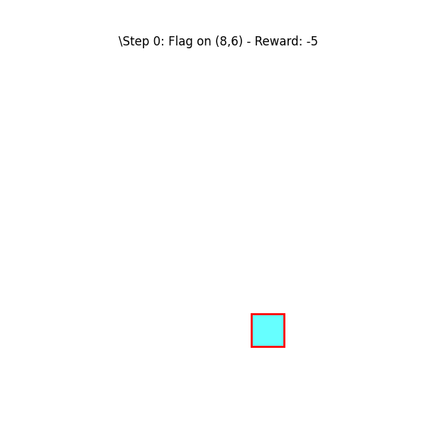

# Cognitive Minesweeper

A Gymnasium environment for studying decisions under spatially varying risk, with a deep Q-network (DQN) agent and a playable version for humans.



In classic Minesweeper, risk comes only from neighbouring mines. Here the 10 × 10 grid is split into four quadrants, and each quadrant draws its tiles from its own risk profile, so some regions are much more dangerous than others. The quadrant-to-profile assignment is reshuffled every few episodes, so a player has to keep relearning where the danger is.

The environment is built for two uses:

- **Reinforcement learning:** a benchmark for agents that must learn risk-averse or risk-seeking behaviour from spatially structured probabilities.
- **Cognitive science:** a behavioural task for studying learning and decision-making under uncertainty, as a structured alternative or complement to tasks like the Iowa Gambling Task. One target is decision-making in neurological conditions such as Parkinson's disease.

The environment passes Gymnasium's `check_env`.

## What's here

| File | Contents |
|---|---|
| `cognitive_minesweeper_env.py` | The environment, `CognitiveMinesweeperEnv` |
| `env_config.py` | Grid size, step limit, remap interval and risk profiles |
| `DQN.ipynb` | A random-agent baseline, then a PyTorch DQN with a replay buffer, a target network and masking of invalid actions |
| `play_minesweeper.py` | A Pygame version for human players |

## Install

```bash
git clone https://github.com/sundarielango95/Minesweeper_DQN.git
cd Minesweeper_DQN
pip install -r requirements.txt
```

## Use it

```python
from cognitive_minesweeper_env import CognitiveMinesweeperEnv

env = CognitiveMinesweeperEnv()
observation, info = env.reset(seed=0)
total_reward = 0.0

while True:
    action = env.action_space.sample()          # replace with your agent
    observation, reward, terminated, truncated, info = env.step(action)
    total_reward += reward
    if terminated or truncated:
        break

print(f"Episode return: {total_reward}")
env.close()
```

To train the DQN agent, open `DQN.ipynb` and run the cells in order.

To play it yourself, run `python play_minesweeper.py`. Left-click reveals a tile, right-click flags it, and **R** restarts when a game ends.

## Configuration

`env_config.py` sets the game. The defaults:

```python
ENV_CONFIG = {
    'grid_size': 10,
    'quadrant_size': 5,
    'max_steps': 200,          # actions per episode
    'remap_interval': 100,     # reshuffle quadrant profiles every N episodes
    'quadrant_profiles': ['low', 'low', 'low', 'high']
}

RISK_PROFILES = {              # (danger, low-risk, safe) proportions
    'high': (0.25, 0.25, 0.5),
    'low':  (0.05, 0.10, 0.85)
}
```

## Environment details

**Observation:** `Box(0, 4, shape=(100,))`, one value per tile: 0 unrevealed, 1 safe, 2 low-risk, 3 danger, 4 flagged.

**Action:** `MultiDiscrete([100, 2])`, meaning a tile index plus an action type (0 click, 1 flag).

**Rewards:**

| Action | Reward |
|---|---|
| Click a safe tile | +10 |
| Click a low-risk tile | −10 |
| Click a danger tile | −50 |
| Flag a danger tile | +5 |
| Flag a safe or low-risk tile | −5 |
| Act on a tile already revealed or flagged | −1, and the step does not count |

**Episode end:** the episode terminates when every tile has been revealed or flagged, and is truncated after `max_steps` actions. Clicking a danger tile costs −50 but does not end the episode.

## Future work

1. Tune the rewards and tile probabilities from empirical testing.
2. Add other information conditions, such as classic Minesweeper neighbour counts.
3. Improve the graphical interface.
4. Log response times and click sequences for cognitive experiments.
5. Benchmark more RL algorithms on the environment.
6. Validate the task as a cognitive assessment.

## Contact

Sundari Elango, sundarielango95@gmail.com
